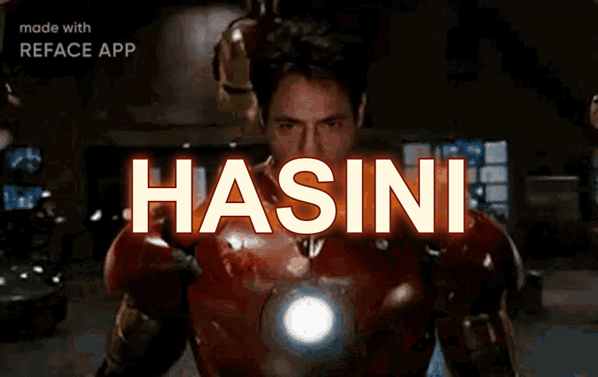

  

### Computer Science Engineering Student

**Aspiring Software Engineer · Problem Solver · Lifelong Learner**

  
  

---

## About Me

I'm Hasini, a B.Tech Computer Science and Engineering student interested in software development, databases, problem-solving, and practical applications of technology.

I believe in learning by building. My goal is to strengthen my programming fundamentals, create useful projects, and continuously expand my technical skills.

- 🎓 **Education:** B.Tech in Computer Science and Engineering
- 💻 **Programming:** Python and Java
- 🗄️ **Databases:** SQL, MySQL and Oracle
- 🌐 **Development:** Exploring modern web technologies
- 📊 **Analytics:** Power BI and Tableau
- 🎯 **Focus:** Problem-solving, practical projects and continuous learning

---

## Technical Skills

**Programming Languages**

**Web Development**

**Databases & Developer Tools**

 

---

## Featured Projects

### 01. Water Leakage & Loss Analyzer

**Python · Oracle Database · SQL**

A course-end project focused on analyzing water leakage complaints and repair records to identify areas associated with significant water loss.

- Manage complaint and repair records using database operations.
- Explore patterns in leakage and repairs.
- Apply Python and SQL concepts to a practical problem.

[View Water Leakage & Loss Analyzer →](https://github.com/hasinimekala-22/Water-Leakage-Analyzer)

### 02. Winter ARC

**React · TypeScript · Vite**

A personal productivity and study-tracking application designed to organize academic goals, habits, and project progress.

- Track daily habits and routines.
- Organize academic goals and exam preparation.
- Monitor learning and project progress.

[Explore my repositories →](https://github.com/hasinimekala-22?tab=repositories)

### 03. DeepRescue

**Soft Robotics · Pneumatic Gripper · CAD Design**

A disaster-response robotics concept exploring a soft robotic gripper for grasping objects during flood and rescue operations.

- Five-finger pneumatic gripper concept.
- Exploration of chamber design and soft materials.
- Focus on robotic manipulation for rescue scenarios.

### 04. CodeGuardian AI

**React · TypeScript · FastAPI · AI**

An AI-assisted developer-tool concept focused on helping users understand code and improve their development workflow.

- Exploring frontend and backend architecture.
- Investigating AI-assisted coding features.
- Developing the concept into a practical software project.

---

## GitHub Statistics

  
  

  

---

## Current Learning Goals

| Area | Focus |
|:--|:--|
| Programming | Python, Java and problem-solving |
| Computer Science | Data structures, algorithms and core concepts |
| Databases | SQL, relational design and database programming |
| Development | Building and improving practical projects |
| Analytics | Power BI, Tableau and data visualization |
| Engineering Design | Exploring AutoCAD and design workflows |

---

### Learn with purpose. Build with consistency.

*Every project is an opportunity to learn, improve, and create something meaningful.*

  

Stark-inspired design · Maintained by Hasini

